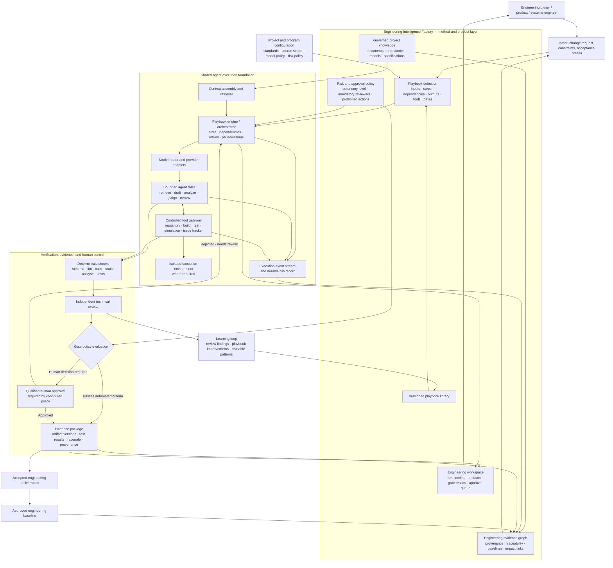

# Claude Update Brief: Engineering Intelligence Factory

**Purpose:** Update the Engineering Intelligence Factory concept and supporting architecture documents to incorporate a clearer platform architecture, reusable execution foundation, engineering evidence graph, risk-based autonomy, and separation between reusable engineering methods and project-specific configuration.

**Important:** This brief is an input for Claude to use while working in the existing repository. It is not a replacement for the current source documents. Inspect the current repository documents before editing, preserve valid decisions and terminology, and reconcile changes rather than blindly appending duplicate sections.

---

## 1. Instructions to Claude

Update the existing concept documentation based on the requirements below.

### Working rules

1. Read `CONCEPT.md`, `PLAN.md`, `ARCHITECTURE.md`, `FACTORY_DEMO_DESIGN.md`, and `DEVELOPMENT_PLAN.md` if they exist.
2. Treat `CONCEPT.md` as the concept-level source of truth. Update supporting documents only where needed to keep terminology and architecture consistent.
3. Do not claim that a component is implemented unless the repository proves it. Clearly distinguish:
   - **Implemented**
   - **Designed / specified**
   - **Planned / not implemented**
4. Preserve the existing core thesis: the platform redesigns the software development lifecycle for AI participation; playbooks define workflows; agents execute bounded roles; gates enforce quality and human accountability.
5. Do not replace the playbook-first approach with an agent-first approach. The platform should make playbooks portable and independent of a particular model provider or agent framework.
6. Keep the concept practical and implementation-oriented. Avoid turning it into generic AI-platform marketing.
7. If a recommendation conflicts with an existing architectural decision, document the conflict and propose a resolution instead of silently changing the decision.
8. Keep diagrams in Mermaid syntax inside Markdown so they can render in Mermaid-enabled Markdown viewers and be exported to HTML by compatible renderers.
9. Validate Mermaid syntax if the repository has a Markdown preview/build tool. Do not introduce a build dependency solely for the diagram without documenting why it is needed.
10. After editing, summarize files changed, major decisions, open questions, and checks performed.

---

## 2. Core architectural position to make explicit

The Engineering Intelligence Factory has two major architectural parts:

### A. Engineering Intelligence Factory — product and engineering-method layer

This layer expresses *what engineering work should happen and what constitutes acceptable evidence*. It includes:

- Versioned engineering playbooks.
- Project and program configuration.
- Project-scoped and explicitly shared knowledge sources.
- Engineering lifecycle use cases across requirements, architecture, design, implementation, verification, validation, and change-impact analysis.
- Requirements and artifact traceability.
- Evidence-based quality gates and risk-based approval policies.
- Deliverables, review queues, and engineering-facing dashboards.

### B. Shared agent execution foundation — runtime layer

This layer provides *how a playbook step is executed*. It should be reusable across playbooks and should avoid embedding business or engineering workflow policy in provider-specific code. It includes:

- Model/provider adapters and model routing.
- Agent/step execution harness.
- Tool registry and controlled tool invocation.
- Retrieval/context assembly.
- Durable run state and resumability where appropriate.
- Sandboxed execution for code and other tools where appropriate.
- Credentials and permission boundaries.
- Structured events, model-call logs, execution traces, and cost/latency observability.
- Retry, timeout, cancellation, and failure-handling behavior.

The interface between these layers should be explicit. A playbook describes steps, inputs, expected outputs, agent role, permitted tools, model profile/policy, and gates. The runtime executes the step and returns structured outputs, events, and evidence to the playbook engine.

Do not assume that every item above must be implemented in the first release. Distinguish the target architecture from the minimum viable slice.

---

## 3. Required concept additions

### 3.1 Playbook, agent, runtime, gate, and evidence distinctions

Add or sharpen definitions so these terms cannot be confused:

- **Playbook:** A versioned, portable workflow definition. Specifies purpose, input/output contracts, steps, dependencies, assigned agent roles, tool permissions, model policy, gates, failure handling, and evidence requirements.
- **Agent:** A bounded execution role that performs a task such as retrieval, drafting, structuring, analysis, judging, review, or other explicitly permitted work. An agent is not itself the complete process.
- **Orchestrator / playbook engine:** Interprets a playbook, manages state and step dependencies, routes work, evaluates gates, and decides whether the workflow can continue, retry, pause, or request human input.
- **Execution foundation/runtime:** Provides model access, tool execution, context assembly, sandboxing where appropriate, durable execution state, and observability.
- **Gate:** A machine-evaluated or human checkpoint with explicit criteria and a recorded outcome. A model-generated score alone must not be treated as sufficient proof for safety-critical or otherwise high-risk acceptance.
- **Evidence:** The source material, artifact, tool result, test result, rationale, review record, or approval supporting a claim or gate outcome.
- **Engineering baseline:** An identified, approved version of relevant requirements, designs, code, tests, and evidence against which changes can be assessed.

Explain that playbooks should orchestrate capabilities through stable interfaces, rather than hard-code a particular model, agent framework, or provider.

### 3.2 Engineering evidence graph

Make traceability a first-class capability, not just a collection of logs.

The concept should describe relationships such as:

- Source statement or stakeholder intent → requirement.
- Requirement → architecture element.
- Architecture element → detailed design element.
- Design element → implementation artifact.
- Implementation artifact → unit/integration/system test.
- Test → execution result, environment, version, and evidence.
- Change request → impacted requirements, designs, code, tests, and approvals.
- Gate → criteria, evidence references, result, timestamp/run, and approver where applicable.

The graph should preserve provenance and version/baseline context. It should distinguish a link that is asserted by a model from one that has been verified by a deterministic tool or accepted by a qualified human. Avoid claiming full semantic graph functionality is already implemented unless code proves it.

The existing claim classifications should be retained and used consistently: **known, observed, inferred, assumed, unknown**. Define them briefly if they are not already defined.

### 3.3 Risk-based autonomy and approval policy

Expand the existing principle that review effort scales with risk. The platform should support policy-driven autonomy, not one universal automation setting.

Illustrative levels:

- **Low risk:** Documentation or formatting; automated execution and checks may be sufficient under project policy.
- **Moderate risk:** Test generation or noncritical code changes; agent execution with deterministic checks and human review as required.
- **High risk:** Changes affecting system behavior or key interfaces; independent verification, impact analysis, and explicit engineering approval.
- **Safety-critical:** Applicable safety lifecycle and engineering process, controlled toolchain, traceable verification evidence, qualified review, and mandatory approval gates.

These are examples, not a replacement for project-specific safety classification or applicable standards. The platform should enforce configured rules such as required reviewers, permitted tools, prohibited actions, and approval conditions. Do not imply an LLM judge can independently certify safety or compliance.

### 3.4 Separate reusable method from project configuration and execution

Describe four distinct concepts:

1. **Engineering method:** Reusable, versioned playbook and its process definition.
2. **Project/program configuration:** Applicable standards, sources, constraints, model policy, tool permissions, safety/risk policy, and approval rules.
3. **Execution instance:** A particular run with input snapshot, playbook version, configuration version, model/profile information, outputs, events, evidence, gate outcomes, and human decisions.
4. **Engineering baseline:** Approved artifact versions and evidence set used for change-impact analysis and comparison.

Enforce project isolation and explicit rules for shared knowledge. Never assume that information from one customer or program can be reused in another. Document the boundaries and expected authorization model.

### 3.5 Observability, auditability, and reproducibility

Build on the existing call log concept. Distinguish at least:

- Model-call records: provider/model profile, timing, token usage when available, status, and cost estimate when available.
- Workflow events: step started/completed, tool invoked, retry, timeout, gate evaluated, human approval requested/granted/rejected, and failure.
- Artifact/evidence records: input and output references, versions/hashes where appropriate, provenance, test results, and reviewer decisions.

Do not log secrets or unnecessarily retain sensitive source content. State that replayability may be limited by nondeterministic models, changing provider versions, external data, and tool side effects. Aim for reproducible inputs and traceable execution, not a false promise of perfectly deterministic AI runs.

---

## 4. Required architecture diagram in `CONCEPT.md`

Add a detailed Mermaid flowchart to the concept document. It must render in a Mermaid-enabled Markdown viewer and be suitable for conversion to HTML. Use the following diagram as a starting point; adjust node names to match the repository's existing terminology, but preserve the architectural distinctions.

### Diagram presentation requirements

- Keep the diagram in the Markdown document as Mermaid source, not as a screenshot.
- Add a short explanatory paragraph before or after it.
- Explain that arrows indicate conceptual information/control flow and not necessarily synchronous calls.
- Make clear that high-risk and safety-critical work can require human approval even when automated checks pass.
- If Mermaid is unsupported in a target renderer, provide a compatible HTML rendering path or document the fallback. Do not remove the source diagram.

---

## 5. Recommended supporting sections

Where appropriate, add or update these sections in `CONCEPT.md`:

1. **Architecture overview** — product/method layer versus execution foundation.
2. **Execution model** — playbook → orchestrator → agent/tool execution → validation → gate → evidence and delivery.
3. **Engineering evidence graph and traceability**.
4. **Risk-based autonomy and human accountability**.
5. **Project isolation and configuration boundaries**.
6. **Observability, auditability, and reproducibility**.
7. **Implementation roadmap and non-goals**.

Keep the current project status table and demo description. Update them only when the actual repository state supports the change.

---

## 6. Implementation implications and sequencing

Do not turn every target-architecture capability into an immediate milestone. Recommend an incremental sequence:

### First vertical slice
Choose one bounded automotive use case from the existing U1–U9 demo list. Trace it from source material through a generated artifact, independent review, gate evaluation, and human approval. Persist the run and its evidence.

### Minimum shared runtime
Implement the model/provider interface, playbook step contract, orchestration state, structured run events, and controlled tool interface. Use the existing local Ollama-first direction unless repository evidence or an explicit decision says otherwise.

### Evidence and gate model
Persist artifact versions/references, source provenance, test outcomes, gate criteria/results, and human decisions. Add links needed for change-impact analysis.

### Expand the playbook library
Only after the first vertical slice is measurable and repeatable, expand to additional requirements, architecture, detailed-design, implementation, verification, validation, and change-impact use cases.

### Measures of success
Track at least:
- Time from task start to accepted deliverable.
- First-pass deterministic validation success.
- Defects and rework found in human review.
- Completeness of traceability/evidence.
- Human review effort.
- Cost per accepted deliverable.
- Repeatability across runs and models.

Avoid using generated lines of code, number of agents, or token volume as primary productivity measures.

---

## 7. Non-goals and cautions

- Do not build a separate custom agent framework for every playbook.
- Do not hard-code the entire engineering process inside an agent prompt.
- Do not assume multi-agent execution automatically improves quality.
- Do not treat an LLM judge score as deterministic proof.
- Do not allow an agent to bypass configured safety, quality, access, or approval gates.
- Do not promise deterministic replay of model outputs.
- Do not merge customer knowledge scopes by default.
- Do not represent planned architecture as implemented functionality.
- Do not introduce blockchain or other infrastructure without a concrete requirement and justified trade-off.
- Do not expand the MVP before one end-to-end workflow has demonstrated value.

---

## 8. Expected output from Claude

1. Update `CONCEPT.md` with the agreed architecture and embedded Mermaid diagram.
2. Update `ARCHITECTURE.md` and `PLAN.md` only where necessary to keep them consistent; preserve detail that belongs in those documents rather than duplicating everything in `CONCEPT.md`.
3. Check whether `FACTORY_DEMO_DESIGN.md` and `DEVELOPMENT_PLAN.md` need terminology or milestone updates.
4. Add a standalone HTML rendering of the architecture diagram only if it fits the repository's conventions. Prefer a small, maintainable solution; if it uses Mermaid from a CDN, document that an internet connection is needed. Keep the Mermaid source authoritative in Markdown.
5. Report:
   - Files changed.
   - Important architecture decisions added or clarified.
   - Any conflicts or unresolved questions.
   - What is implemented versus only designed or planned.
   - Tests, Markdown rendering, and diagram validation actually performed.

Do not claim tests or rendering checks passed unless they were actually run.
