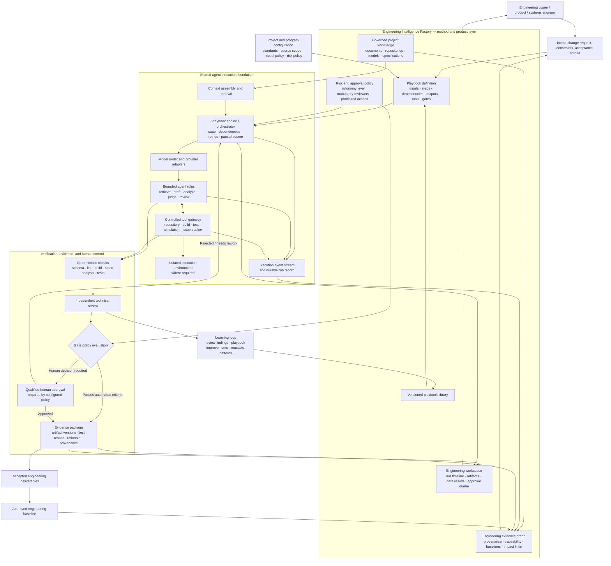

# Engineering Intelligence Factory — Concept

**Status as of 2026-10-20.** Each capability below is labelled **Implemented**, **Designed / specified**, or **Planned / not implemented**. A label is only "Implemented" where the repository shows the code.

**Written for:** stakeholders and engineers joining the project.

---

## 1. Purpose

The Engineering Intelligence Factory redesigns the software development lifecycle for a world where AI participates in the work. It is not "SDLC plus AI agents."

Project material (documents, spreadsheets, git repositories, stakeholder input) is turned into governed knowledge. That knowledge drives engineering artifacts such as requirements, architecture, design, code, and tests. Independent reviewers check each artifact, and gates enforce quality and human accountability before anything is accepted.

Core thesis, which the rest of this document applies:

- **Playbooks** define the workflow.
- **Agents** execute bounded roles inside a step.
- **Gates** enforce quality and human accountability.
- The platform does not depend on any single model provider or agent framework.

Design sources: [PLAN.md](PLAN.md) (build plan and data model), [ARCHITECTURE.md](ARCHITECTURE.md) (architectural rationale), [FACTORY_DEMO_DESIGN.md](FACTORY_DEMO_DESIGN.md) (demo), [DEVELOPMENT_PLAN.md](DEVELOPMENT_PLAN.md) (build order).

---

## 2. Architecture overview

The platform has two major parts. The interface between them is the step contract described in §4.

### A. Engineering Intelligence Factory — method and product layer

Expresses *what engineering work should happen and what counts as acceptable evidence*.

- Versioned playbook library.
- Project and program configuration (standards, sources, model policy, tool permissions, risk and approval rules).
- Project-scoped knowledge, plus explicitly shared sources.
- Engineering lifecycle use cases: requirements, architecture, detailed design, implementation, verification, validation, change impact.
- Requirements and artifact traceability (the evidence graph, §6).
- Evidence-based gates and risk-based approval policy (§7).
- Deliverables, review queues, and engineering dashboards.

### B. Shared agent execution foundation — runtime layer

Expresses *how a playbook step is executed*. It is reusable across playbooks and contains no engineering workflow policy.

- Model and provider adapters, with model routing.
- Step execution harness (agent invocation, structured output validation).
- Tool registry and controlled tool invocation.
- Context assembly and retrieval.
- Durable run state and resumability.
- Sandboxed execution for code and other tools, where appropriate.
- Credentials and permission boundaries.
- Structured events, model-call logs, execution traces, cost and latency observability.
- Retry, timeout, cancellation, and failure handling.

**Target architecture versus minimum slice.** Not every runtime capability ships in the first release. §10 separates the target from the first vertical slice.

---

## 3. Core definitions

These terms have fixed meanings across all documents.

| Term | Definition |
|---|---|
| **Playbook** | A versioned, portable workflow definition. Specifies purpose, input and output contracts, steps, dependencies, agent roles, tool permissions, model policy, gates, failure handling, and evidence requirements. Plain YAML plus prompt files. |
| **Agent** | A bounded execution role that performs one task: retrieval, drafting, structuring, analysis, judging, review, or other explicitly permitted work. An agent is one part of a step, not the whole process. |
| **Orchestrator (playbook engine)** | Interprets a playbook, manages state and step dependencies, routes work to agents, evaluates gates, and decides whether the workflow continues, retries, pauses, or requests human input. |
| **Execution foundation (runtime)** | Provides model access, tool execution, context assembly, sandboxing where appropriate, durable run state, and observability. |
| **Gate** | A checkpoint, machine-evaluated or human, with explicit criteria and a recorded outcome. A model-generated score alone is never sufficient proof for high-risk or safety-critical acceptance. |
| **Evidence** | The source material, artifact, tool result, test result, rationale, review record, or approval that supports a claim or a gate outcome. |
| **Engineering baseline** | An identified, approved set of versions of requirements, designs, code, tests, and evidence. Changes are assessed against a baseline. |

**Playbooks orchestrate capabilities through stable interfaces.** A playbook names a role and a model profile. It does not name a model, a framework, or a provider.

---

## 4. Execution model

A playbook step runs in this order:

1. **Inputs resolved.** The orchestrator resolves declared inputs from governed knowledge and prior step outputs, using the project's configuration.
2. **Context assembled.** The runtime builds the context from allowed sources only (see §8).
3. **Agent executes.** A bounded agent role runs through the model router, and may call tools from the permitted list.
4. **Output validated.** The step output is checked against its declared schema. Deterministic checks run where defined (schema, lint, build, static analysis, tests).
5. **Gate evaluated.** The gate policy compares the results with the configured criteria. The outcome is one of: continue, retry, pause, or request human approval.
6. **Evidence recorded.** The step's inputs, outputs, tool results, and gate decision are stored as evidence with provenance.
7. **Delivery or rework.** Accepted output is added to the deliverable and, once approved, to the engineering baseline. Rejected output returns to the orchestrator for rework.

Arrows in §5 show conceptual information and control flow. They do not imply synchronous calls.

**Example step.** U1 (intent to requirements), from the demo library, runs: retrieval agent → drafting agent → structuring agent → independent judge (a different model family) → gate. A failed judge returns to drafting, capped by `max_iterations`. A pass goes to the human approval gate.

### 4.1 Intake and triggers

Work enters the factory through intake. Intake is itself a playbook, U0 `intake-and-triage`, so it follows the same rules as every other playbook: versioned, gated, and recorded as evidence. It is the only playbook that starts from an external event.

**Trigger.** An event in a source system starts U0: a chat message or reaction, an issue created or updated in a tracker, a webhook, or a schedule. Every trigger carries its source reference (system, key, and link) and is recorded before anything else happens.

**Nested services.** U0 contains services, not agents. Services are deterministic code. Only the classifier may call a model, and only when the rules cannot decide.

| Service | Job | Rule |
|---|---|---|
| Source connector | Receives the event and fetches its full content | Authenticated and read-only by default |
| Deduplicator | Drops repeated events for the same source item | Idempotent: one source item starts at most one run |
| Normalizer | Converts the source into a brief: title, body, attachments, links | Source text is data, never a prompt. Instructions found in it are quarantined |
| Classifier | Assigns the request type: feature, defect, enhancement, or change request | Rules first (issue type, labels). A model decides only ambiguous items, and its answer is recorded as evidence |
| Router | Picks the target playbook from a configured routing table | Deterministic for a given classification. Low confidence sends the item to a gate |
| Handoff | Starts the child run with the source reference, brief, and routing decision | The target playbook receives the handoff contract only, never the raw source |

**Handoff contract.** The handoff is the only input a target playbook receives from intake: source reference, normalized brief, classification with its basis, and routing decision. A target playbook never reads the source system directly.

**Chaining.** Playbooks chain by emitting events, not by nesting. When U1 `intent-to-requirements` completes, it emits an event that starts U2 as a child run. Every run records its parent, so one request can be followed through the whole V-cycle.

**Traceability.** The chain starts at the source reference. Requirements, design, code, tests, and releases link back to it through the evidence graph (§6), so every artifact can be traced to the request that caused it.

**Gates at the boundary.** A human gate applies when routing confidence is low. Another applies before any write-back to a source system, such as changing a tracker status or posting a comment. Intake never acts on a source system without one of these gates.

### 4.2 Resources per step

Every step uses the cheapest resource that can decide correctly. Four kinds of resource exist. Each step declares which ones it may use, and the orchestrator enforces that declaration.

| Resource | Used for | Rule |
|---|---|---|
| **Automation** (deterministic code) | Connectors, deduplication, normalization, routing, schema and lint checks, build, tests | Preferred whenever a rule can decide. No model call |
| **Local model** (Ollama) | Drafting, judging, review, and the classifier's fallback for ambiguous items | The default for model work. The local-only project policy is enforced on the server (built in M2) |
| **Cloud AI API** (Anthropic, OpenAI, Azure, or similar) | An optional profile where quality needs it, such as a Builder or a judge | Deferred until the local path is complete. Allowed only where the project policy permits. Credentials come from a secrets store, never from a playbook |
| **Human** | Gates, approvals, and disputes between reviewers | Required wherever the risk policy (§7) requires it |

**Order of preference.** Rules before models. Local before cloud. A person whenever the risk requires one. A step that needs a cloud profile still runs its automation checks first, and its output still passes the same gates.

**Independence.** A judge uses a different model family from the drafter. With local models only, that means two families (for example Qwen and Gemma). Vendor independence comes with the cloud adapters.

---

## 5. Architecture diagram

The diagram is Mermaid source embedded in this Markdown, so it renders in any Mermaid-enabled viewer. Arrows show conceptual flow, not synchronous calls. High-risk and safety-critical work requires human approval even when every automated check passes.

**Rendering.** This block is plain Mermaid source inside Markdown. Any Mermaid-enabled Markdown viewer can render it. The Markdown block is the authoritative source, and no build step or external service is used to produce a rendered copy.

**Implementation status of the diagram's nodes:**

| Node group | Status |
|---|---|
| Human, intent, configuration | Designed. Intent and configuration entities are planned. |
| Playbook definition, library | Designed (PLAN §3.3). Parser is planned (M6). |
| Governed knowledge | Partly implemented: `KnowledgeSource` and `Chunk` tables and CRUD exist (M1). Ingestion is planned (M3). |
| Evidence graph | Designed (§6). Not implemented. |
| Risk and approval policy | Designed (§7). Not implemented. |
| Workspace UI | Static demo pages exist (§9). Not connected to the backend. |
| Model router and provider adapters | Partly implemented: provider interface, Ollama adapter, resolver, policy check, call accounting (M2). The Claude adapter is deferred |
| Orchestrator, context, agents, tools, sandbox, events | Planned (M4–M8). Not implemented. |
| Deterministic checks, review, gates, approval | Planned. Not implemented. |
| Evidence package, deliverables, baseline | Designed. Not implemented. |

---

## 6. Engineering evidence graph and traceability

Traceability is a first-class capability, not just a set of logs. The graph holds these relationships:

- Source statement or stakeholder intent → requirement.
- Requirement → architecture element.
- Architecture element → detailed design element.
- Design element → implementation artifact.
- Implementation artifact → unit, integration, or system test.
- Test → execution result, environment, version, and evidence.
- Change request → impacted requirements, designs, code, tests, and approvals.
- Gate → criteria, evidence references, result, timestamp and run, and approver where applicable.

Every link records:

- **Provenance:** the source it came from.
- **Version or baseline context:** which artifact version it refers to.
- **Assertion type:** whether a model asserted the link, a deterministic tool verified it, or a qualified human accepted it.

**Claim classifications** used across all artifacts: **known, observed, inferred, assumed, unknown**. Model-asserted links are "inferred" until verified. Verified links are "observed" (tool) or "known" (accepted by a qualified human).

**Current state.** The requirements draft in PLAN §2 carries `source_refs[]` on each requirement, and `Chunk` carries `source_ref`. Those are the only traceability fields in the data model today (the `source_ref` column exists; `RequirementItem` does not). The typed, versioned graph is **designed** and planned for M9. Nothing in §6 is implemented yet.

---

## 7. Risk-based autonomy and human accountability

Review effort scales with risk, and each project configures the policy. The platform does not use one universal automation setting.

Illustrative levels. These are examples, not a substitute for a project's own safety classification or the applicable standards.

| Level | Typical work | Autonomy and checks |
|---|---|---|
| **Low** | Documentation, formatting | Automated execution and checks may be sufficient under project policy |
| **Moderate** | Test generation, noncritical code changes | Agent execution with deterministic checks; human review as the policy requires |
| **High** | Changes to system behavior or key interfaces | Independent verification, impact analysis, explicit engineering approval |
| **Safety-critical** | Work under a safety lifecycle | Applicable safety process, controlled toolchain, traceable verification evidence, qualified review, mandatory approval gates |

**Enforced by configuration, not by prompts:** required reviewers, permitted tools, prohibited actions, and approval conditions. An agent cannot bypass these.

**The platform does not certify safety or compliance.** An LLM judge's score is not proof, and a deterministic check passing is not approval. High-risk and safety-critical outcomes always route to a qualified human.

**Current state.** The rule-based policy engine is **designed** (PLAN §3.4 and ARCHITECTURE §2.3). Gates are **planned** (M5–M8). No gate code exists.

---

## 8. Project isolation and configuration boundaries

The method and the configuration are separate, and so is each run.

| Concept | What it is | Example |
|---|---|---|
| **Engineering method** | A reusable, versioned playbook and its process definition | `intent-to-requirements` v1 |
| **Project or program configuration** | The applicable standards, sources, constraints, model policy, tool permissions, risk policy, and approval rules | The mobility program's standards list and "local-only" model policy |
| **Execution instance (`PlaybookRun`)** | One run, with its input snapshot, playbook version, configuration version, model profiles, outputs, events, evidence, gate outcomes, and human decisions | One run of U1 on 2026-10-20 |
| **Engineering baseline** | Approved artifact versions and the evidence set used for change-impact analysis | The approved requirements set v1.0 |

**Isolation rules.**

- Knowledge is scoped to a project by default. Retrieval filters by project. Shared sources must be linked explicitly.
- Information from one customer or program is never reused in another by default.
- A project flagged "local-only" must reject any step whose model profile resolves to a cloud provider. This is enforced server-side (PLAN §3.4).

**Current state.** The `Project` entity has a knowledge-scope policy field and the `KnowledgeSource` entity is linked to a project (M1, implemented). Retrieval filtering, shared-source linking, and the enforcement rules are **designed** and planned for M4 and M10. Authorization (RBAC) is planned for M10.

---

## 9. Observability, auditability, and reproducibility

Three kinds of record are kept separate:

- **Model-call records:** provider and model profile, timing, token usage where the provider reports it, status, and a cost estimate where available. Stored in `CallLog`.
- **Workflow events:** step started and completed, tool invoked, retry, timeout, gate evaluated, human approval requested, granted, or rejected, and failure.
- **Artifact and evidence records:** input and output references, versions or hashes where appropriate, provenance, test results, and reviewer decisions.

**Rules.**

- Secrets are never logged.
- Sensitive source content is not retained unnecessarily. Records hold references, not copies, where possible.
- Replayability is limited by non-deterministic models, changing provider versions, external data, and tool side effects. The goal is reproducible inputs and traceable execution. Deterministic replay of model output is not promised.

**Current state.** `CallLog` is **implemented** as a table with provider, model id, token fields, estimated cost, latency, and a nullable `playbook_run_id`. The accounting wrapper writes a row for each successful call (M2 row 2.6). Calls are not yet linked to a run, because there is no `PlaybookRun` table. The event stream and artifact records are **designed** and planned (M5, M9).

---

## 10. Roadmap and non-goals

### 10.1 Implementation sequence

Each step is an increment, and each is measured before the next begins.

1. **First vertical slice.** Choose one bounded automotive use case from the demo list. Recommended: **U1 `intent-to-requirements`**. It is already the most specified use case and matches PLAN §1 (v1 scope). Trace it from source material through a generated artifact, an independent review, a gate evaluation, and a human approval. Persist the run and its evidence.
2. **Minimum shared runtime.** The model provider interface (Ollama first), the playbook step contract, orchestration state, structured run events, and the controlled tool interface. Ollama-first follows the existing direction (PLAN §3.4 and `.env.example`).
3. **Evidence and gate model.** Persist artifact versions, source provenance, test outcomes, gate criteria and results, and human decisions. Add the links needed for change-impact analysis.
4. **Expand the playbook library.** Only after the first slice is measurable and repeatable: requirements, architecture, detailed design, implementation, verification, validation, and change impact (U2–U9).

**Mapping to the existing milestones** ([DEVELOPMENT_PLAN.md](DEVELOPMENT_PLAN.md)):

| Sequence step | Milestones |
|---|---|
| Already done | M0, M1 |
| First vertical slice | M2 (model layer), M5–M6 (orchestrator, playbook engine), M7 (intent-to-requirements agent), M8 (judge and refinement), plus the thin U1 path |
| Minimum shared runtime | M2, M5 |
| Evidence and gate model | M8, M9 |
| Playbook library expansion | Post-M9, after measurement. Not yet scheduled |

### 10.2 Measures of success

Track at least:

- Time from task start to accepted deliverable.
- First-pass deterministic validation success.
- Defects and rework found in human review.
- Completeness of traceability and evidence.
- Human review effort.
- Cost per accepted deliverable.
- Repeatability across runs and models.

Do not use lines of generated code, number of agents, or token volume as primary productivity measures.

### 10.3 Non-goals and cautions

- Do not build a separate custom agent framework for each playbook.
- Do not hard-code the whole engineering process inside an agent prompt.
- Do not assume multi-agent execution improves quality on its own.
- Do not treat an LLM judge score as deterministic proof.
- Do not let an agent bypass configured safety, quality, access, or approval gates.
- Do not promise deterministic replay of model output.
- Do not merge customer knowledge scopes by default.
- Do not represent planned or designed architecture as implemented.
- Do not introduce blockchain or other infrastructure without a concrete requirement and a justified trade-off.
- Do not expand the MVP before one end-to-end workflow has shown value.

---

## 11. Current status

| Area | Status | Evidence |
|---|---|---|
| Repository and tooling (M0) | **Implemented** | Python project, Docker Compose Postgres with pgvector, Alembic, lint and test tooling |
| Core data model and CRUD API (M1) | **Implemented** | `Project`, `ModelProfile`, `KnowledgeSource`, `Chunk`, `CallLog`; FastAPI routes; repository layer; tests |
| Test suite | **Implemented, all passing** | 75 passed, coverage 79%. Includes the M2 tests. The schema test that failed on 2026-10-20 (`test_model_profile_cloud_without_api_key`) now passes: a Pydantic v2 field validator was skipped when the field was omitted, so the cloud-key check moved to a model-level validator on `ModelProfileCreate` |
| Frontend demo pages | **Implemented as static mock UI** | Pages for agents, factory, gates, playbooks (including `requirements-from-mixed-sources`), runs, evidence, and traceability, all reading static data from `frontend/src/app/demo/data.ts`. No `fetch` calls, so they are not connected to the backend |
| Model layer (M2, rows 2.1, 2.3–2.7) | **Implemented** | `LLMProvider` interface and contract tests (`src/llm/base.py`, `tests/test_llm_contract.py`); Ollama adapter (`src/llm/ollama.py`); profile resolver with server-side local-only policy (`src/llm/resolver.py`); `CallLog` accounting wrapper (`src/llm/accounting.py`); M2 integration test (`tests/test_m2_integration.py`) |
| Claude adapter (M2, row 2.2) | **Deferred** | Enterprise adapters come after the local path, per the demo design. The resolver raises a typed `UnsupportedProviderError` for cloud profiles until then |
| Local model manager (M2, rows 2.8–2.17) | **Planned / not implemented** | Catalog, pull client, checksums, health check, and the profile guard are not built |
| Local model manager (M2) | **Designed / specified** | PLAN §3.4 |
| Ingestion (M3) | **Planned / not implemented** | `src/ingestion/` is empty |
| Embedding and retrieval (M4) | **Planned / not implemented** | |
| Orchestrator and agent framework (M5), playbook engine (M6) | **Planned / not implemented** | `src/orchestrator/` and `src/playbooks/` are empty packages |
| Intake and triggers (U0, §4.1) | **Designed / specified** | Not built. Source connectors and the routing table come after the first vertical slice |
| Agents, judge, traceability (M7–M9) | **Planned / not implemented** | |
| Auth, RBAC, cross-project governance (M10) | **Planned / not implemented** | |
| Demo (use-case playbook library, dashboard, token panel) | **Designed / specified** | [FACTORY_DEMO_DESIGN.md](FACTORY_DEMO_DESIGN.md). Not built |
| Evidence graph (§6) | **Designed / specified** | This document |
| Risk and approval policy (§7) | **Designed / specified** | This document, PLAN §3.4 |
| Engineering baseline | **Designed / specified** | This document |

**Repository layout.** `README.md` and `CLAUDE.md` are at the root. Project documents are in `docs/`. Code is in `src/`, `frontend/`, `tests/`, and `alembic/`.

---

## 12. Decisions, conflicts, and resolutions

These are the places where the new architecture meets an existing decision. Each is resolved here, and none is changed silently.

| # | Existing decision | Conflict | Proposed resolution |
|---|---|---|---|
| 1 | PLAN §3.2: orchestrator is "LangGraph-style" or a small custom state machine | A framework choice would become a dependency of the playbook engine | Playbook format and the runtime interface are framework-neutral. LangGraph may be used as one implementation behind the engine, never as a dependency of the playbook format. Decide at M5 |
| 2 | PLAN §3.2: judge must use a different vendor from the drafter | The demo uses local models only | The demo uses two different model families (for example Qwen and Gemma). Vendor independence is enforced once enterprise adapters exist (FACTORY_DEMO_DESIGN §2.3) |
| 3 | PLAN §1: v1 scope is requirements generation only | The demo library covers U1–U9 across the V-cycle | The first vertical slice is U1 only. U2–U9 start after the slice is measured (§10.1) |
| 4 | PLAN §3.2–3.3 and ARCHITECTURE §2.5: humans review uncertainty; the Approver may auto-merge | CLAUDE.md requires the user to check the running app after every feature | The two apply at different levels. CLAUDE.md governs how this project is built, so every feature is human-checked. Auto-merge, where a project allows it, is set per project by the risk policy (§7) and is off by default |
| 5 | PLAN §2 calls the run record `PlaybookRun`. The target brief calls it an execution instance | Two names for one concept | Use `PlaybookRun` as the name for the execution instance (§8) |
| 6 | PLAN §2 traceability via `source_refs[]` on requirements | The brief asks for a typed, versioned evidence graph | `source_refs[]` stays as the first, simple form. The typed graph is a planned generalisation in M9. Each link records provenance, version, and assertion type (§6) |
| 7 | ARCHITECTURE §5 lists Evidence, Agent, and Gate as entities | PLAN §2 does not define them as tables | Keep them as planned entities. They are added with the evidence and gate model (§10.1 step 3) |

### 12.1 Operating-model lessons from other factory products

Other products run software work as a team of agents connected to repositories, with requests arriving from chat and issue trackers. This section records what this concept adopts from that model, and what it does not. Each lesson is stated in this concept's own terms.

| Lesson | How this concept applies it | Decision |
|---|---|---|
| Group repositories that ship together into one project. Keep separate products in separate projects | Project scope (§8). Do not split one product by team or task; specialise with agent roles and skills instead | Adopt |
| Keep the originating request with the run from intake to handoff | A run (`PlaybookRun`, §8) keeps a reference to its source (issue, thread, or document) through to the evidence package (§6) | Adopt |
| Connect external intake sources such as chat, issue trackers, and webhooks | Intake playbook U0 with nested services (§4.1) | Adopt as a playbook. Its build follows the first vertical slice (§10.1) |
| A coordinating agent that can skip stages or send work back | Orchestrator (M5) with rework capped by `max_iterations`. Every reroute is recorded as evidence | Adopt, with the cap and the record |
| Agent models and instructions are editable and reviewed | Agent roles bound to model profiles (FACTORY_DEMO_DESIGN §2.2). Profiles and instructions are configuration, not code | Adopt |
| Factory configuration kept in a repository and changed through pull-request review | Playbooks as versioned YAML (PLAN §3.3). A playbook change is reviewed like code | Adopt |
| The factory never merges; branch protection controls merging | Auto-merge off by default (§12 row 4) | Already aligned |
| Dashboard metrics: activity, autonomy, cycle time, and cost | Token and cost panel (FACTORY_DEMO_DESIGN §2.4), plus autonomy rate (share of gate decisions passed without escalation) and cycle time (run start to approval) | Adopt |
| Score configurations and compare them on the same tasks | Judge (§12 row 2) and the measures in §10.2. Compare model profiles on the same fixed playbook input, which also tests repeatability (FACTORY_DEMO_DESIGN §4) | Defer to M9 |
| Propose improvements to the factory automatically | Not planned | Do not adopt in v1. Any proposed change to a playbook or prompt must pass human review first |
| A seven-stage delivery loop: triage, spec, implement, review, verify, ship, monitor | V-cycle (FACTORY_DEMO_DESIGN §2.3). It pairs each build stage with its verification | Keep the V-cycle |
| Cloud-hosted execution, with managed self-hosting for enterprises | Local-first models (§1; ARCHITECTURE). Enterprise provider adapters come later | Differs by design. Self-hosted cloud execution is not a v1 goal |

**Where this concept differs.** Playbooks, gates, and evidence are the core of this concept, and the lessons above do not replace them. The gate-and-evidence model is what makes a run auditable and lets a reviewer check a claim without reading every line.

---

## 13. Open questions

1. **Engineering baseline storage:** should baselines be immutable snapshots of artifact versions, or references into a version-control system? Decide before the evidence model (step 3).
2. **Evidence depth:** does the evidence package hold all test runs, or a summary with links to the full logs? (Carried over from ARCHITECTURE §12.)
3. **Retention:** how long are source content and prompts kept, given that sensitive material should not be retained unnecessarily?
4. **Default local model:** the laptop GPU has about 4 GB of VRAM. Which model profile is the default for interactive runs? Benchmark before choosing.
5. **Safety classification:** which risk levels and gates apply to each domain? A project decision, not a platform default (ARCHITECTURE §12).
6. **Enterprise adapter order:** which provider comes first after Ollama (Anthropic, OpenAI, Azure OpenAI, or Bedrock)?
7. **Playbook authoring:** YAML first, or a visual builder? (ARCHITECTURE §12.)
8. **Work intake:** resolved. Intake is playbook U0 with nested services (§4.1). Which source system is connected first is a delivery decision, not a design question.

---

## 14. Related documents

- [PLAN.md](PLAN.md): build plan, data model, roadmap, risks.
- [ARCHITECTURE.md](ARCHITECTURE.md): architectural rationale and design decisions.
- [FACTORY_DEMO_DESIGN.md](FACTORY_DEMO_DESIGN.md): demo design and use-case playbooks.
- [DEVELOPMENT_PLAN.md](DEVELOPMENT_PLAN.md): atomic, test-gated build order.
- [DEV_WORKFLOW.md](DEV_WORKFLOW.md): how each build step is developed and tested.
